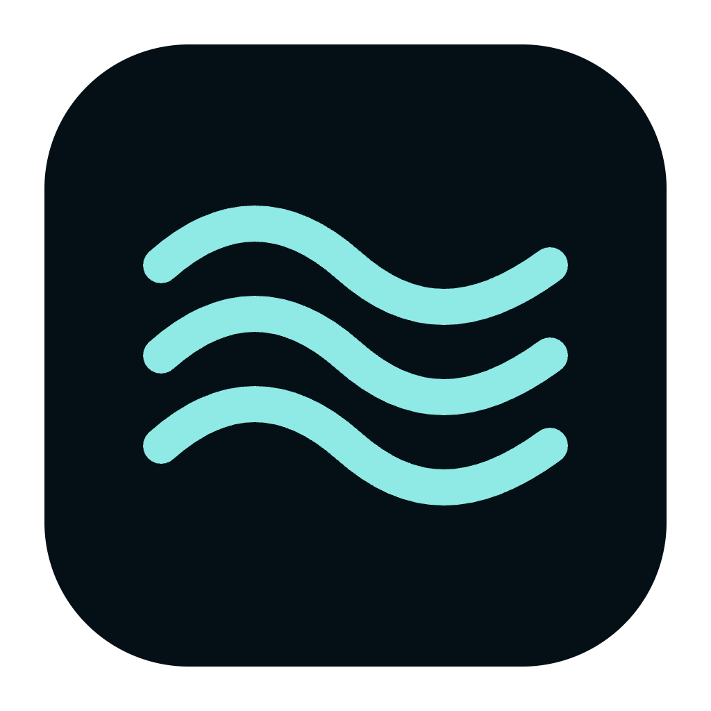
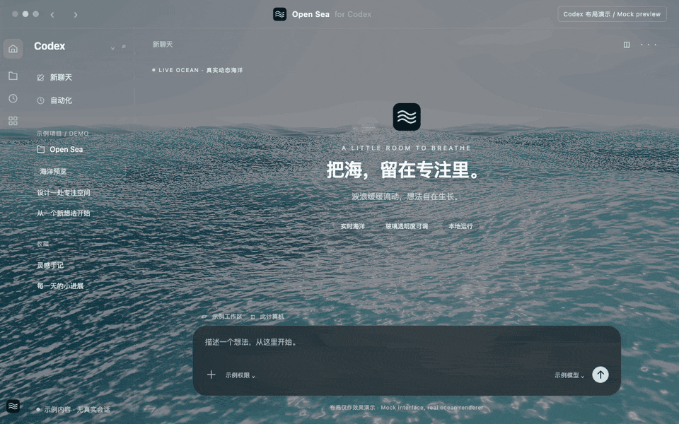
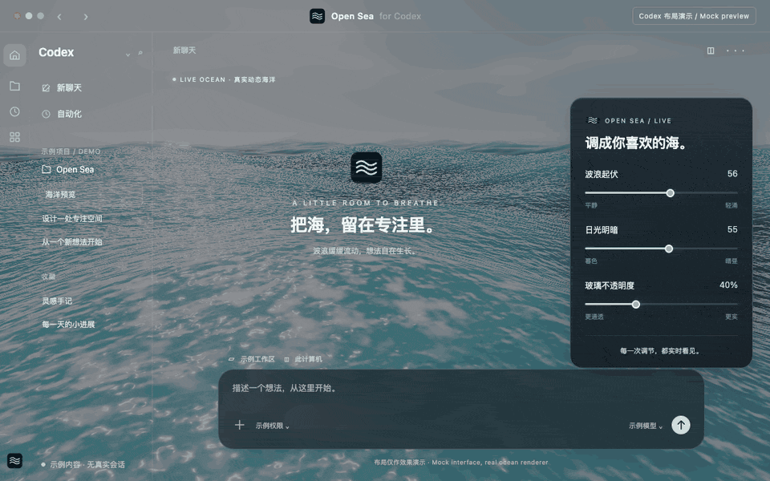
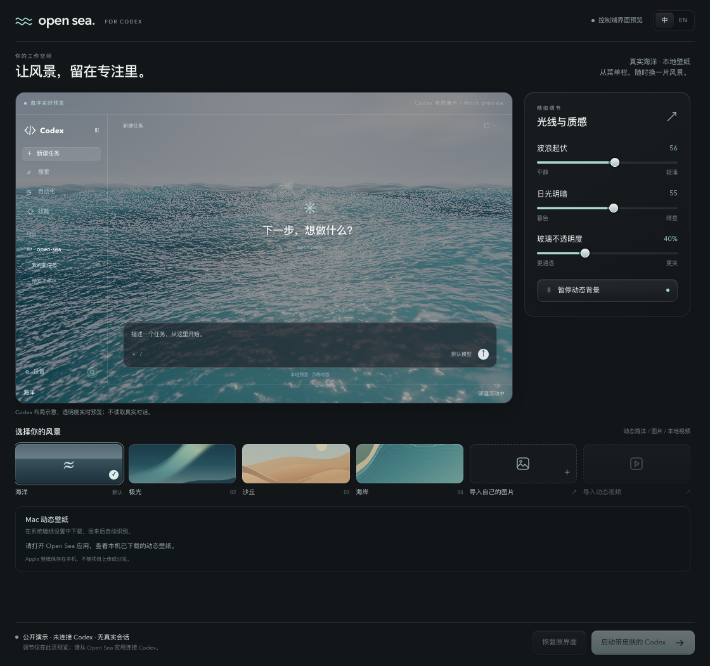

<div align="center">



# 🌊 Open Sea for Codex

**给 Codex 的工作区，留一片会动的海。**

实时海洋 · 通透玻璃 · 本地动态壁纸 · 菜单栏与系统托盘

**简体中文** · [English](README.en.md)

[📦 下载 Beta](https://github.com/d-dev0101/open-sea-for-codex/releases) · [📖 安装指南](docs/INSTALL.zh.md) · [💬 问题与建议](https://github.com/d-dev0101/open-sea-for-codex/issues)

<p>
  <a href="https://github.com/d-dev0101/open-sea-for-codex/releases"></a>
  <a href="LICENSE"></a>
  <a href="https://github.com/d-dev0101/open-sea-for-codex/actions/workflows/ci.yml"></a>
</p>

非商业用途免费 · 商业用途需单独授权。[许可范围与说明](docs/COMMERCIAL-LICENSE.md)。

</div>



[▶ 查看高清演示视频](docs/media/hero-dark.mp4) · [演示素材说明](docs/media/README.md)

> 🎬 **演示说明**：本页动图使用真实海洋渲染器，叠加示例 Codex 布局录制。它展示海洋和控制面板的效果，**不是官方客户端的完整实机录屏**；画面不含真实私人会话。

Open Sea 是搭配 **官方 Codex 桌面客户端** 使用的独立本地控制端。选一片海、调整光线和玻璃不透明度，再把背景应用到 Codex 的主界面。

**安装方式是下载桌面应用。无需 npm 登录，无需终端命令。** 当前为 `v0.1.0-beta.1` Beta；下载文件和验证范围以各次 Release 的实际附件与说明为准。

## 🚀 三步开始

**先准备好：** 安装并正常打开[官方 Codex 桌面客户端](https://openai.com/codex/)。

### 1️⃣ 下载适合你电脑的版本

前往 **[Releases 下载页面 →](https://github.com/d-dev0101/open-sea-for-codex/releases)**，按下表选择文件：

| 你的电脑 | 选择的安装包 | 当前验证范围 |
| --- | --- | --- |
| 🍎 Mac · Apple 芯片（M 系列） | `mac-arm64` 的 `.dmg` 或 `.zip` | 用户已确认真实 Codex 中的动态海洋、顶部透明导航正常；其他效果见验证记录 |
| 🍎 Mac · Intel | `mac-x64` 的 `.dmg` 或 `.zip` | 已有架构构建与签名检查；尚未完成 Intel Mac 手动验证 |
| 🪟 Windows · x64 | `win-x64` 的 `.exe` | **实验性**：已有构建与自动化检查，尚未完成原生 Windows 手动验证 |

不确定 Mac 芯片？点 **苹果菜单 → 关于本机**。只选择 Release 实际提供的文件；GitHub 的 `Source code` 是源码，不是安装包。

### 2️⃣ 安装并打开 Open Sea

- **Mac**：打开 `.dmg`，把 **Open Sea for Codex** 拖进“应用程序”；若下载 `.zip`，先解压再移入。
- **Windows**：运行 `.exe` 安装向导，再从开始菜单打开 **Open Sea for Codex**。

首次打开的系统提示与处理方式见[安装指南](docs/INSTALL.zh.md)。Mac 包采用 ad-hoc 签名，尚无 Apple 开发者签名或公证；Windows 包尚无发布者签名。

### 3️⃣ 点击「启动带皮肤的 Codex」

保持默认“海洋”，或先在预览中选好背景，再点击启动。新 Codex 窗口如出现登录页，完成登录并等待主界面即可。

💡 日常从 **Mac 菜单栏 / Windows 系统托盘** 点 Open Sea 图标，就能重新打开设置。关闭面板只会隐藏窗口。

## ✨ 让工作区更像你

| 功能 | 可以做什么 |
| --- | --- |
| 🌊 **实时海洋** | 调节波浪起伏、日光和夕阳；动画可暂停 |
| 🫧 **玻璃不透明度** | 15–90% 连续可调，默认 40%；数值越小，背景越清晰 |
| 🎛️ **即时布局预览** | 用 16:10 的示例侧栏、工作区与圆角输入框，查看换肤后的整体感觉 |
| 🖼️ **自己的风景** | 导入图片或本地视频，也可选择极光、沙丘、海岸三张静态预设 |
| 🍎 **本机 Mac 动态壁纸** | 发现已下载的系统视频；从面板打开系统墙纸设置，下载后回来选择 |
| 📍 **随手调节** | 菜单栏 / 托盘切换背景、暂停、恢复原界面；中文默认，可切英文 |



[▶ 查看高清调节视频](docs/media/controls-demo.mp4)

<details>
<summary>🎛️ View the controller / 查看控制面板</summary>



</details>

图片支持 PNG、JPEG、WebP（最大 10 MiB）；视频支持 MOV、MP4、M4V、WebM（最大 2 GiB），静音循环播放。手动导入视频能否播放，还取决于系统与编码格式。

### 🍎 Mac 系统壁纸怎么用？

**去系统下载 ↗ → 在 macOS 墙纸设置中下载 → 返回 Open Sea → 选择壁纸。**

首次使用会在本机生成最高 1080p、30 fps 的静音 H.264 播放副本，并显示进度；系统原片保持不变，再次使用可复用缓存。转换工具随 Mac 应用提供，无需另装 ffmpeg 或 Swift。

本机一次约 5 分钟的 4K/240fps 壁纸测试中，首次准备从 **110.5 秒缩短到 36.0 秒**。这是特定设备和视频的实测；其他视频按兼容情况处理。[查看测试范围 →](docs/VALIDATION.md)

视频保存在本机，皮肤功能不会上传。Apple 壁纸由用户在系统设置中下载，**不随本项目或安装包分发**。

## 🔄 更新、恢复与常见问题

<details>
<summary><strong>已经装过旧版，怎么更新？</strong></summary>

从菜单栏 / 托盘选择 **退出 Open Sea**，等待图标消失 → 安装并打开新版 → 点击 **启动带皮肤的 Codex**。

关闭面板窗口并没有退出旧版。设置和已导入的本机壁纸可以保留，无需删除数据目录。[详细更新步骤](docs/INSTALL.zh.md#更新已有版本)

</details>

<details>
<summary><strong>为什么可能需要再登录一次？</strong></summary>

Open Sea 使用独立的浏览器配置启动受管理的官方 Codex 窗口，因此可能需要首次登录。普通启动沿用现有 `CODEX_HOME`，未设置时使用 Codex 的默认目录；**独立浏览器配置不等于聊天数据隔离**。

“控制器已就绪”表示面板可用，预览正常不代表已经连接 Codex。请以实际主界面和面板状态为准。[状态说明](docs/INSTALL.zh.md#看懂状态)

</details>

<details>
<summary><strong>怎么恢复原界面？会修改官方应用吗？</strong></summary>

点击 **恢复原界面** 移除背景与样式。Open Sea 通过验证后的本机回环 CDP 连接应用皮肤，不修改官方应用包或内容安全策略（CSP）。

选择 **退出 Open Sea** 会退出控制端，并在限定时间内尝试清理皮肤；它不会退出 Codex。若要关闭此次启动的调试端口，请退出 **Open Sea 启动的 Codex 实例**，再正常打开 Codex。CDP 具有操作页面的能力，本机回环地址不等于对同机进程的身份认证。[隐私与安全说明](docs/SECURITY.md)

</details>

## 🧪 兼容性与反馈

这是独立社区 Beta，与 OpenAI、Apple 无隶属关系。已记录的 macOS 原生验证对应 Codex `26.1021.31345`；官方客户端更新后可能需要适配。控制面板、浏览器模拟布局与自动化测试，不能替代所有平台的完整实机验证。

遇到问题，欢迎到 **[Issues](https://github.com/d-dev0101/open-sea-for-codex/issues)** 提供系统、芯片架构、Codex / Open Sea 版本及错误提示。截图前请遮去账号、私人会话和个人路径。

📚 [安装与使用](docs/INSTALL.zh.md) · [验证记录](docs/VALIDATION.md) · [隐私与安全](docs/SECURITY.md)

<details>
<summary><strong>🛠️ 从源码运行</strong></summary>

需要 Node.js 22+；Mac 源码构建另需含 Swift 与 macOS SDK 的 Xcode Command Line Tools。使用安装包不需要这些开发工具。

在克隆后的仓库目录中执行：

```sh
npm ci
npm start
```

`npm test` 运行测试；`npm run package` 构建当前环境支持的安装包。构建成功不代表目标平台已经完成实机验证。

</details>

## 🙏 致谢

海洋渲染保留 [Open Sea Skin](licenses/open-sea-MIT.txt) 与 [Three.js](licenses/three-MIT.txt) 的第三方 MIT 许可声明。客户端识别与生命周期设计参考 [Codex Dream Skin](https://github.com/Fei-Away/Codex-Dream-Skin)，本项目采用独立实现，并保留其[参考许可声明](licenses/reference-MIT.txt)。按钮视觉参考 [solid-glass](https://github.com/deeplethe/solid-glass)，未复制其 CSS 或代码。

## 📄 使用许可

本项目**源码公开，非商业用途免费**，采用 [PolyForm Noncommercial 1.0.0](LICENSE)。这不是 OSI 定义的开源许可。

**除 LICENSE 明确允许的用途及法定权利外，商业使用需事先取得单独的书面授权**，包括公司内部商业使用、收费衍生产品、转售与商业捆绑。请先阅读[商业授权说明](docs/COMMERCIAL-LICENSE.md)；可通过[商业授权申请](https://github.com/d-dev0101/open-sea-for-codex/issues/new?template=commercial_license.yml)表达合作意向，公开 Issue 中不要填写私人联系方式、合同或其他敏感信息。

第三方 MIT 组件继续遵循其原有许可，具体范围见[第三方声明](THIRD_PARTY_NOTICES.md)。
